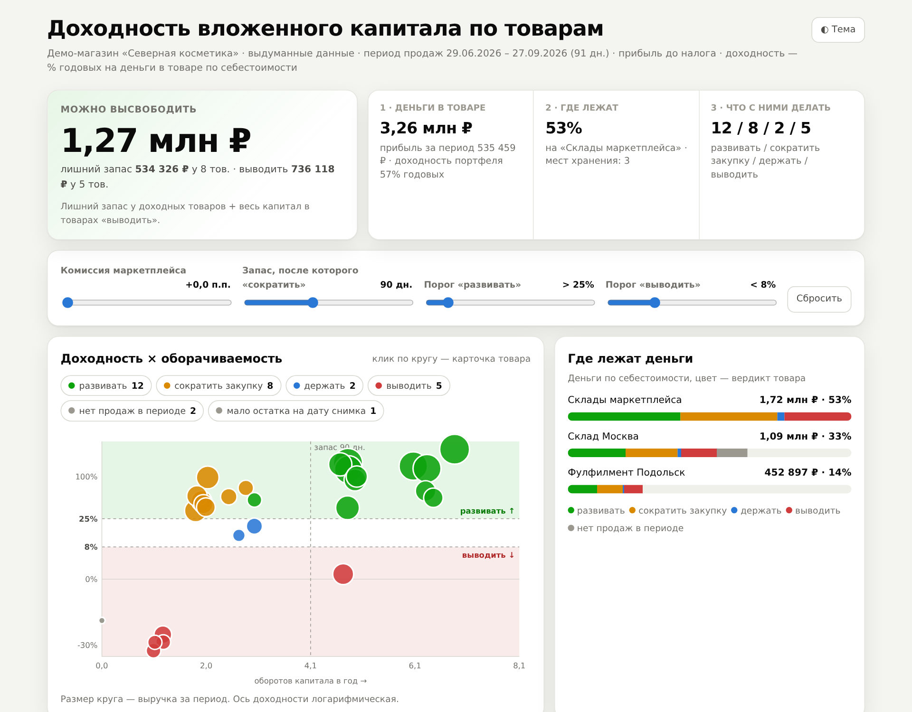
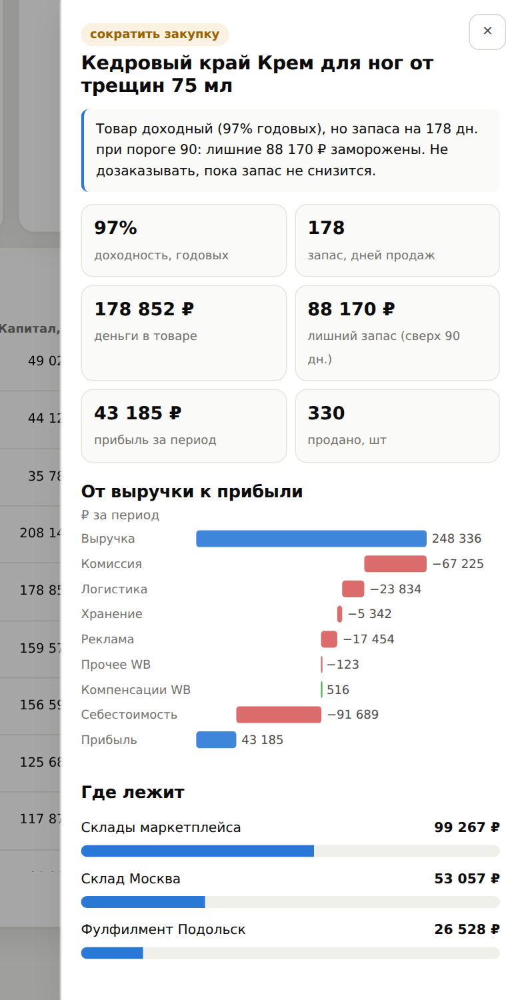

# Доходность вложенного капитала по товарам WB

[](https://github.com/yaroslav-lavrushko/wb-dohodnost-kapitala/actions/workflows/tests.yml)
[](https://yaroslav-lavrushko.github.io/wb-dohodnost-kapitala/)

**Какие товары возвращают вложенные деньги, а какие замораживают их на складе.** По выгрузкам Wildberries
программа считает по каждому товару прибыль, деньги в остатках на всех складах и годовую доходность этих денег,
и даёт решение: **развивать, сократить закупку, держать или выводить**.

**[▶ Открыть веб-версию](https://yaroslav-lavrushko.github.io/wb-dohodnost-kapitala/)** — считает прямо в браузере,
файлы не покидают компьютер · **[Демо-отчёт](https://yaroslav-lavrushko.github.io/wb-dohodnost-kapitala/demo/)** на
выдуманном магазине



## Какие решения помогает принять

- **Куда не докладывать деньги.** Товар может быть прибыльным, но держать запас на полгода — колонка «лишний запас, ₽»
  показывает, сколько денег можно высвободить, если не дозаказывать.
- **Что выводить.** Товары, где деньги работают хуже депозита, — с суммой, которая вернётся после распродажи.
- **Где лежат деньги.** Склады маркетплейса, свой склад, фулфилмент — сколько денег и каких товаров в каждом месте.
- **Что будет при росте комиссии.** Ползунок «комиссия +N п.п.» пересчитывает прибыль и вердикты всего ассортимента.



Клик по любому товару открывает карточку: почему у него такой вердикт, путь от выручки к прибыли
(комиссия, логистика, хранение, реклама, себестоимость) и на каких складах лежат деньги. Ползунки порогов
пересчитывают всё сразу; отчёт — один HTML-файл, работает без интернета, есть тёмная тема и версия для телефона.
К отчёту прилагается Excel: итог, матрица, P&L по товарам, где лежат деньги, сценарий комиссии, себестоимость
по поставкам и лист проверок.

<br clear="right">

## Как пользоваться

**1. В браузере — с любого компьютера.** Откройте [веб-версию](https://yaroslav-lavrushko.github.io/wb-dohodnost-kapitala/),
перетащите выгрузки, нажмите «Посчитать». Расчёт идёт на вашем компьютере (Python в браузере через
[Pyodide](https://pyodide.org)): файлы никуда не отправляются. Страница загружает только код — Python-среду
с открытого CDN (~15 МБ, один раз) и расчётное ядро с этого сайта.

**2. На своём компьютере** (Python 3.10+; использование кода — с разрешения автора, см. [лицензию](#лицензия)):

```bash
pip install "git+https://github.com/yaroslav-lavrushko/wb-dohodnost-kapitala"
wb-capital --in папка-с-выгрузками --out папка-отчёта
```

**3. С Claude** — скилл в [`skill/SKILL.md`](skill/SKILL.md): Claude запускает ту же программу и пишет выводы.

## Какие выгрузки нужны

| Что | Где взять | Обязательно |
|---|---|---|
| Еженедельные детализации WB (xlsx или zip) | Личный кабинет WB → Финансовые отчёты → детализация | да |
| Каталог себестоимости по поставкам | Своя таблица: лист «Каталог (себестоимость)», колонки «Номер поставки», «Название товара», «Себестоимость» ([шаблон](https://yaroslav-lavrushko.github.io/wb-dohodnost-kapitala/template/каталог-себестоимости-шаблон.xlsx)) | да |
| Остатки | Отчёт WB «Остатки по складам», выгрузка своего склада или фулфилмента (1С, МойСклад и т. п.) — любые и сколько угодно | для доходности |

Тип файла программа определяет по колонкам, имена файлов не важны. Если колонок не хватает — она пишет, каких
именно и в каком файле, и не падает.

## Как считается

- **Прибыль товара** = к перечислению за товар (продажи − возвраты) + компенсации WB − логистика − хранение −
  штрафы − реклама и прочие удержания − себестоимость. Расходы без артикула (реклама одной суммой, хранение)
  разносятся по выручке или по деньгам в остатке; сумма по товарам всегда сходится с итогом кабинета.
- **Себестоимость** — по паре «поставка × артикул»: у каждой поставки своя цена закупки.
- **Деньги в товаре** — весь товар во всех местах хранения и в пути, по цене последней поставки. Остатки на одну
  дату по разным местам складываются, одно место на разные даты — усредняется. Товар определяется по коду WB.
- **Доходность** = прибыль за период, приведённая к году, ÷ деньги в товаре. **Запас, дней** = деньги в товаре ÷
  себестоимость продаж в день.
- **Вердикты** (пороги настраиваются в [`config.json`](wb_capital/config.json) и ползунками в отчёте):

| Вердикт | Правило по умолчанию |
|---|---|
| развивать | доходность > 25% годовых, запас ≤ 90 дней |
| сократить закупку | доходность > 25%, но запас > 90 дней и лишнего ≥ 10 000 ₽ |
| держать | доходность 8–25% |
| выводить | доходность < 8% — деньги работают хуже депозита |
| нет продаж в периоде | остаток есть, продаж нет — новинка или неликвид, проверить дату прихода |
| мало остатка на дату снимка | денег в остатке меньше 1 000 ₽ — доходность не считается, нужен снимок на другую дату |
| нет данных об остатке / нет себестоимости | товара нет в файлах остатков или в каталоге — программа просит данные, а не угадывает |

Программа ничего не угадывает: строки без заголовка, повторно поданный файл, снимок остатков вне периода продаж —
попадают в предупреждения, а не молча в расчёт.

## Конфиденциальность

- Веб-версия считает в браузере: выгрузки не уходят ни на GitHub, ни на другие серверы.
- В репозитории нет реальных данных: демо-магазин «Северная косметика» и тестовые файлы полностью выдуманы
  ([генератор](demo/make_demo.py)). `.gitignore` не пускает в репозиторий выгрузки и отчёты, а
  [`scripts/check_leaks.py`](scripts/check_leaks.py) в CI ищет реквизиты, контакты и личные запретные слова.

## Для разработчика

```
wb_capital/        расчётное ядро: чтение выгрузок, себестоимость, остатки, P&L, отчёты (Excel + HTML)
web/               веб-версия (Pyodide): тот же пакет wb_capital в браузере
demo/              генератор выдуманного магазина и его данные
tests/             pytest: эталонные итоги, все вердикты, битые файлы, правила остатков
scripts/           сборка сайта, проверка на утечки
skill/             скилл для Claude
```

```bash
pip install -e ".[test]" && pytest -q        # тесты
python scripts/build_site.py --out _site     # сайт для GitHub Pages
python demo/make_demo.py                     # пересобрать демо-магазин
```

## Лицензия

© 2026 Ярослав Лаврушко. Все права защищены. Код открыт для просмотра; веб-версию и демо можно свободно
открывать и пробовать для ознакомления. Любое другое использование — с письменного разрешения. См. [LICENSE](LICENSE).
